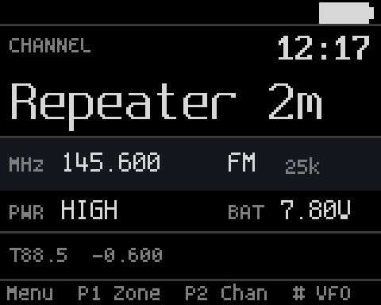

# DeltaMM

Open firmware for DMR and FM handheld radios, written from scratch in
C++20.



The first target is the AnyTone D878UVII. The radio features sit apart
from the board support, so a new radio, or the desktop simulator, is a
new board folder rather than a fork.

DeltaMM is for licensed radio amateurs. It is not affiliated with or
endorsed by AnyTone or the makers of the chips it drives.

## Features

**FM radio.** Receive and transmit using the radio's own factory
calibration. Squelch levels, repeater offsets, four power levels, a
transmit timeout and amateur-band limits. CTCSS and DCS tones both ways,
with the codeplug's squelch mode (implemented, not yet tested on the
radio).

**DMR radio.** Voice calls so far: receive and transmit through a
repeater, using the radio's own calibration. Calls on the channel's
talkgroup, its receive group list or to the radio itself are heard,
others stay muted; through a repeater only the channel's slot. A heard call fills the screen with the
caller's callsign and name from the codeplug's contacts and user
directory. PTT wakes an idle repeater and calls the channel's contact.
Direct (simplex) calls, voice enhancement and the shaped amplifier
keying at High and Turbo are implemented, not yet tested on the radio.

**Frequency offset.** For a radio whose frequency reference has
drifted, an offset in 62.5 Hz steps, up to 5 kHz either way, moves every
receive and transmit frequency back onto the nominal one. Menu >
Settings > Radio or the console's `fm offset <Hz>` sets it, and it is
kept across restarts. What it is for and how to find the value is in
`docs/frequency-offset.md`.

**Roaming.** A DMR channel with roaming on works through a repeater of
the codeplug's roaming zone, so one channel per talkgroup covers a whole
network. Between calls the radio learns the repeaters' beacons and
visits the others briefly to keep their levels, and with the codeplug's
automatic roaming on it moves to a clearly better repeater by itself.
Searches, on a side key set to roaming or when PTT finds no repeater,
try the most likely repeaters first. The codeplug's repeater range check
is followed. Menu > Roaming turns roaming off or picks another roaming
zone, and its Status shows what the radio hears. How to
set roaming up and use it is in `docs/roaming-setup.md`, the design in
`docs/design/roaming.md`; moving between two real repeaters is still to
be tested.

**Channels.** Channels, zones and the VFO come from the codeplug already
on the radio. Pick zones from a list, step channels with the knob, or type
a frequency on the keypad.

**Interface.** A first version of the user interface: a home screen in
rows that the menu sets (talkgroup or zone, the time, the channel or
contact large, frequency or a signal meter, power with the voltage or
volume, and details, the last caller or the GPS position), and a
short grouped settings menu. A transmit screen while the user's own
call or FM transmission is on the air, and activity pages (Menu > Tools >
Activity): calls heard and made, roaming moves and GPS fixes
(`docs/hw-tests/activity.md`). Settings changed on the radio are kept in
the codeplug (`docs/settings-storage.md`). Key lock covers the keypad,
side keys and knob, with auto lock and forced lock.

**Codeplug editing.** Menu > Tools > Codeplug edits the codeplug on the
radio: channels, zones, contacts, receive groups, the roaming repeaters
and zones, radio IDs, the settings and APRS. Each record lists its known
fields by name, on pages that P1 and P2 turn (a channel's Basic, DMR, FM
and APRS), and then every one of its bytes, so a value without a named
field can still be changed. Names are typed letter by letter (a key again
for its next letter, `#` for capitals, `*` to delete, the knob through
every character), frequencies and IDs on the keypad, and the rest chosen
on the menu's value screens. Leaving a record with changes lists them,
old and new; Menu saves, `#` drops them. A saved channel or zone takes
effect at once; the settings restart the radio. Saving takes the same
path as a write from the PC, never while one runs, after the settings
kept on the radio, and reaches only the codeplug's own blocks. The
console's `plug peek <address> [count]` and `plug poke <address>
<byte>...` (hexadecimal) read and write codeplug bytes the same way.
`prog watch on` logs each run of bytes a write from the PC changes, old
and new, to learn where a setting lives.

**Battery.** Battery save cycles the receiver while the radio is idle,
with the codeplug's setting, and the backlight goes off after its light
time. A battery monitor and auto power-off.

**GPS.** The built-in receiver, on or off with the codeplug's setting or
from the menu, using the satellite systems the codeplug or the menu
chooses (GPS, BeiDou, GLONASS). A GPS screen with position, altitude,
satellites, speed and UTC time, and a GPS mark in the status bar. With
battery save on, the receiver sleeps between fixes and wakes in time for
the next one the clock or the GPS screen needs; the mark is amber while
it sleeps.

**Clock.** The radio's real-time clock keeps UTC while the radio is off; a
GPS fix corrects it. The home screen shows the local time from the
codeplug's time zone, or UTC as `HH:MMZ` (Menu > Settings > Clock >
Shown as). Menu > Settings > Clock > Calibrate measures the clock against
GPS time for 30 or 60 minutes and corrects its rate, so it keeps time
between fixes and while the radio is off. The receiver's timing wanders
by a few milliseconds, so a 30-minute run gets the rate to within about
5 ppm (0.4 s a day); a 60-minute run does better.

**APRS.** Position beacons from the GPS, with the codeplug's APRS
callsign, path, symbol, comment and frequency, at the codeplug's interval
or now from the menu. Each packet waits for a free channel and goes out
simplex on the APRS frequency at low power; from another channel the radio
goes there and comes back. Without an APRS frequency in the codeplug no
beacon goes out. The radio's BT+APRS board decodes received packets while
the radio is on their frequency, and a list shows the stations heard with
their distance and bearing. Menu > APRS holds Send now, Auto send (the
interval) and Heard; Menu > Settings > APRS the send power and Receive (the
board on or off); the stations heard are also the third activity page.
`APRS` in the status bar shows that beacons go out on their own. The
console's `aprs` logs the station and the beacon state, `aprs send` sends
a beacon (`aprs send here`: on the current channel, for tests), `aprs every
<s>` sets the interval, `aprs lead <ms>` and `aprs level <%>` the packet's
lead-in and audio level, and `gps fake <lat> <lon>` (10^-4 degrees) makes
up a position for tests (`docs/hw-tests/aprs.md`).

**APRS mode.** Holds the radio's one receiver on the codeplug's APRS
frequency until it is turned off, and decodes the packets on the MCU
itself (`docs/dedicated-modes.md`). The home screen then shows the station
heard last with its distance and bearing, the stations and packets heard,
and the next beacon; PTT sends a beacon, never voice. The mode is kept
over a restart, and turning it off tunes back to the channel as it was.
The MCU decoder runs seven slicers for different tone balances on the
received audio and hears far more than the BT+APRS board's decoder
(in one overnight run the MCU decoded 33 of 35 beacons, the board none).
Both feed the same heard list, so a packet either one decodes counts.

**Programming.** Codeplug tools that speak the radio's own programming
protocol read and write the codeplug over USB. Tested with QDMR.

**Platform.** Beeps, volume and backlight. A USB log with a debug
console, and crash details kept across restarts.

**Tools.** `dmm-radio` backs up the radio, prepares the update files and
flashes them.

## Roadmap

1. Audio level adjustment: volume range and steps, FM and DMR levels in
   both directions, beeps and tones
2. Refined user interface: screen layouts, menus, icons and fonts tuned
   as features are added
3. Programming over USB, compatible with existing codeplug tools
4. Scan and dual watch
5. Clock from GPS time, with the codeplug's time zone
6. Calibration tool
7. APRS, Bluetooth, recording, DTMF and selective calling
8. Complete DMR: talkgroups and contacts picked on the radio, private
   call set-up and replies, call log, talker alias, radio check and the
   other DMR functions, roaming, SMS and data

## Getting started

### 1. Build

Host build: unit tests, simulators and `dmm-radio`. It needs Qt 6.8 with
Qt Quick and Qt Serial Port; without Qt, the core libraries and their
tests build.

```sh
cmake --preset host -DCMAKE_PREFIX_PATH=/path/to/Qt/6.8.x/gcc_64
cmake --build --preset host
ctest --preset host
build/host/boards/sim_qt/simqt     # the simulator
```

Firmware, with the Arm GNU Toolchain 14.2 or newer on `PATH` or in
`ARM_GNU_TOOLCHAIN`:

```sh
cmake --preset fw-d878uv2-release -DDMM_STOCK_FIRMWARE=/path/to/firmware.CDD
cmake --build --preset fw-d878uv2-release
```

If a configure failed, for example before the toolchain was found,
configure again from scratch with `--fresh` (or delete the build folder):
a failed first configure can leave the build without optimisation, and
such firmware does not start.

The D878UVII's DMR baseband chip, the SCT3258, needs a 2 KB boot program
made for that chip, loaded into it at every power-on. The build takes it
from your own copy of the radio's factory firmware update file
(`DMM_STOCK_FIRMWARE`) and checks its hash. Everything that uses the
SCT3258, FM audio included, is built when this option is given.

### 2. Back up the radio

Save the radio's per-unit data (calibration and radio information) while
the factory firmware is still on it:

```sh
dmm-radio backup          # 2-5 minutes, includes the whole system area
dmm-radio backup --quick  # calibration and radio information only
dmm-radio list
```

Backups go to your user data folder, outside this repository. A backup is
marked verified once every check passes.

### 3. Flash

DeltaMM is sent through the radio's own update mode (power on holding
PTT and PF3, the top key) as three update files. They are made from the
DeltaMM image and your factory `.spi` and `.CDI` files, once a verified
backup exists:

```sh
cmake --preset fw-d878uv2-release -DDMM_STOCK_FIRMWARE=/path/to/firmware.CDD \
    -DDMM_RADIO_TOOL=/path/to/dmm-radio
cmake --build --preset fw-d878uv2-release --target update-files
```

Switch the radio on in update mode (red LED blinking) and send the files
with `dmm-radio`:

```sh
dmm-radio flash build/fw-d878uv2-release/boards/anytone_d878uv2/package/DeltaMM_<version>.CDD
```

With `--wait 600`, the tool waits up to ten minutes for the radio to be
switched on in update mode. The radio starts the new firmware when the
transfer ends.
`docs/update-mode.md` describes update mode.

The radio's boot loader stays as it is, so the factory firmware can be
flashed back the same way at any time, `dmm-radio flash <factory .CDD>`
included. Each release has a hardware checklist in `docs/hw-tests/`.

## Using the radio

| Key | Standby screen |
| --- | --- |
| Channel knob, Up/Down | Next or previous channel, or VFO step |
| `0`-`9` | Type a frequency |
| `#` | Switch between VFO and memory |
| P1 | Zone list |
| P2 | Channel settings (squelch, power) |
| Menu | The menu |
| Hold `*` | Lock keys; Menu then `*` unlocks |
| Hold Exit | Cycle standby, log and key test screens |

The menu lists what is used while operating first: Channel (squelch,
squelch type, power), Roaming (status, on or off, roaming zone), GPS
(status, receiver on or off) and Display (brightness, light time).
Settings holds the setup in groups: Home screen (a preset, or what each
row shows), Audio (DMR and FM microphone gain), Radio (frequency
offset), Keys & battery (what the lock covers, auto lock, battery save),
Clock (time zone, local time or UTC, calibration) and GPS (satellite
systems).
Tools opens the log and the key test and shows the version. The panel
under the list says what the chosen row does. Menu opens a group or a
row's value screen, where Menu sets the value and Exit leaves it as it
was; Exit goes back one level, onto the row it came from. A value
changed in the menu is kept across restarts (`docs/settings-storage.md`).
Choosing GPS > Status opens the GPS screen, and Exit or Menu goes back to
the list. The console's `gps raw on`
logs every sentence the receiver sends; `gps query`, `gps restart` and
`gps send` talk to the receiver itself; `gps need <s>` asks for a
position every so many seconds (0: none). `time` logs the clock and its
rate correction, `time set YYYY-MM-DD HH:MM:SS` sets it (UTC),
`time cal <min>` calibrates it against GPS time for so many minutes (0
stops a run), and `time cal reset` removes the rate correction.

APRS mode is the first row of Menu > APRS. While it is on, Up, Down and the
knob open the heard list, Menu opens Menu > APRS, P2 the activity pages,
PTT sends a beacon, and P1, `#` and the digits are refused with the notice
"In APRS mode". Menu > Settings > APRS > Hear packets opens the speaker for
packets in the mode (quiet by default). On the console, `aprs mode on|off`
turns it on and off, `aprs rx` reports both decoders, `aprs rx mcu
on|off|any` sets where the MCU decodes (in the mode, never, or on any
analog channel for a test) and `aprs rx repair on|off` lets it repair a
frame with one wrong bit or tone (off by default). Checklists:
`docs/hw-tests/aprs-mode.md` and `docs/hw-tests/aprs-rx.md`.

The GPS mark in the status bar, shown while the GPS is on:

| Colour | Receiver |
| --- | --- |
| Green | has a fix |
| Grey | is searching for satellites |
| Amber | sleeps between fixes (battery save on) |
| Red | sends no data |

## Programming the codeplug

The radio codeplug can be updated using the original CPS software or compatible software.

Contact list updating is not yet supported.

## Log and console

A radio running DeltaMM shows up as two USB serial ports, "DeltaMM data"
and "DeltaMM log". Open the log port with any terminal program at any
speed; lines written before the port was opened arrive first. Type `help`
for the console commands.

For tests, `key <name> [long]` presses a key (named as on the key test or
in the log) and `knob <steps>` turns the channel knob. `screen shot`
writes the drawing of the whole screen to the log, and
`tools/screen_picture/screen_picture.py <log> <out.png>` puts the picture
together. `screen watch <s>` streams the drawing for that many seconds
(`screen on` and `screen off` without a time limit); `--passes <dir>` then
writes a picture after each redraw, and `--flicker` counts the pixels
painted twice in one redraw, which show as a flash. `screen text` writes
each run of text on the screen with its place and colours.
`tools/radio_test` runs hardware checklists through these commands on a
radio or on the headless simulator (`sim --stdin` takes console commands
from standard input) and writes a report.

## Project layout

| Folder | Contents |
| --- | --- |
| `lib/` | Containers and utilities, heap-free and OS-free |
| `os/` | Task, queue and mutex API: FreeRTOS on radios, Qt threads on the PC |
| `hal/` | CPU core and MCU support, one folder per MCU family |
| `drivers/` | Chip drivers |
| `services/` | Radio, storage, log, power and the interfaces the app uses |
| `app/` | User interface and features |
| `boards/` | One folder per radio, plus the simulators |
| `tools/` | PC tools, `dmm-radio` among them |
| `tests/` | Host unit tests |
| `docs/hw-tests/` | One hardware checklist per release |
| `docs/update-mode.md` | Flashing through the boot loader |
| `docs/loader.md` | DeltaMM's loader: updates over USB with a fallback |

`ARCHITECTURE.md` describes how the parts fit together, `AGENTS.md`
lists the coding and commit rules, and `CREDITS.md` thanks the people who
helped.

## Disclaimer

DeltaMM comes without any warranty. Installing it voids the radio's type
approval for anything but amateur use; you are responsible for
transmitting only where and how your licence allows. AnyTone and the chip
names used here are trademarks of their owners.

## Licence

MIT, see `LICENSE.md`. The Spleen font in `third_party/spleen/` is
BSD-2-Clause. The repository follows the REUSE specification.
